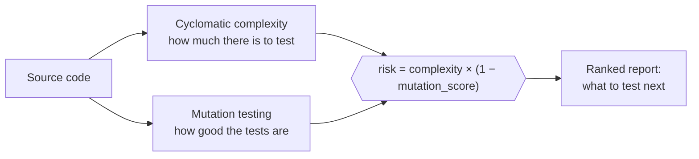

<div align="center">
#  susgrade
 
### See what's *actually* worth testing.
 
Complexity **×** test quality, fused into one plain-language risk report.<br>
Know exactly which function to test next.
 
<br>
[**🚀 Live demo**](https://codemasteraman.github.io/SUSGRADE/) &nbsp;·&nbsp; [**Quick start**](#-quick-start) &nbsp;·&nbsp; [**CLI & CI**](#-cli--ci-gates) &nbsp;·&nbsp; [**API**](#-api-reference)
 
<br>
[](https://www.python.org/)
[](https://fastapi.tiangolo.com/)
[](https://docs.pydantic.dev/)
[](https://github.com/CodemasterAman/SUSGRADE/actions/workflows/ci.yml)


 
<br>
<a href="https://codemasteraman.github.io/SUSGRADE/">
  
</a>
</div>
<br>
## ✨ At a glance
 
| | |
|---|---|
| 🧮 **Complexity** | Exact McCabe cyclomatic complexity for **12 languages**, each via a real parser |
| 🧬 **Mutation testing** | Inject faults, run your tests, see every mutant that slipped through |
| 🎯 **Fused risk report** | Ranks functions by `complexity × (1 − mutation_score)` |
| 🚦 **CI gates** | `susgrade` CLI with exit codes + ready-to-run GitHub Actions workflow |
| 📦 **Repo scan** | Drop a folder or paste a public GitHub repo, get a ranked cross-file report |
| 📤 **Exports** | JSON, CSV, Markdown or PDF, generated client-side |
| 🌐 **Zero backend option** | The whole web app runs in your browser (Pyodide), hosted free on static pages |
 
---
 
## 💡 Why susgrade
 
Writing tests is easy. Knowing **which code deserves them** is hard, especially early in your career.
 
1. **Where is the risk?** Branch-heavy functions have many paths, and every path can hide a bug.
2. **Is that risk actually tested?** Line coverage shows a line *ran*, not that a test would *catch a bug* in it.
Coverage tools and complexity tools answer these separately. susgrade points at the overlap: **code that is both complex *and* weakly tested**, which is exactly where real bugs survive.
 
---
 
## 🧠 The core idea
 

 
| Signal | Question it answers | Basis |
|---|---|---|
| **Cyclomatic complexity** | How many independent paths must be tested? | McCabe, 1976: decision points + 1 |
| **Mutation score** | Would my tests catch a real bug? | Fraction of injected faults (`>` → `>=`, `+` → `-`, `True` → `False`) that your tests kill |
 
A complex, poorly tested function rises to the top. A trivial or well-tested one sinks.
 
---
 
## 🚀 Quick start
 
**Try it now, no install:** open the **[live demo](https://codemasteraman.github.io/SUSGRADE/)** and paste some code.
 
**Run locally** (Python 3.10+, no database or API keys):
 
```bash
cd backend
python -m venv .venv
source .venv/bin/activate          # Windows: .venv\Scripts\activate
pip install -e ".[dev]"            # API + tests + the `susgrade` CLI
uvicorn app.main:app --reload
```
 
API → **http://127.0.0.1:8000** &nbsp;·&nbsp; Swagger docs → **http://127.0.0.1:8000/docs**
 
Then open `frontend/index.html` in a browser. It's a single file with no build step.
 
---
 
## 📊 Risk bands
 
| Complexity | Band | Meaning |
|:---:|---|---|
| **1 – 5** | 🟢 `simple` | Easy to test |
| **6 – 10** | 🟡 `moderate` | Worth a deliberate set of tests |
| **11 – 20** | 🟠 `complex` | Many paths; test thoroughly, consider refactoring |
| **21+** | 🔴 `very complex` | Refactor candidate before it grows further |
 
Thresholds follow standard McCabe guidance, so numbers are comparable with tools like `radon`.
 
---
 
## 🚦 CLI & CI gates
 
susgrade doesn't just measure test quality, it can **enforce** it.
 
```bash
# Complexity gate: fail if any function is too branchy
susgrade check app --max-complexity 10
 
# Mutation gate: fail if the suite doesn't catch enough faults
susgrade mutation --source examples/subject.py --tests examples/test_subject.py --min-score 0.8
 
# Risk gate: fuse both per function, fail on hotspots
susgrade risk --source examples/subject.py --tests examples/test_subject.py --max-risk 5
```
 
All commands accept `--format text|json`.
 
| Exit code | Meaning |
|:---:|---|
| `0` | All gates passed (or report-only run) |
| `1` | A threshold was crossed, so fail the build |
| `2` | Bad usage, or a file couldn't be read or parsed |
 
**GitHub Actions** — a ready-to-run workflow lives at [`.github/workflows/ci.yml`](.github/workflows/ci.yml):
 
```yaml
- run: pip install -e "./backend[dev]"
- run: pytest backend/tests -q
- run: susgrade check backend/app --max-complexity 10
- run: susgrade mutation --source examples/subject.py --tests examples/test_subject.py --min-score 0.9
```
 
> susgrade checks susgrade: the complexity gate runs over its own source on every commit.
 
Prefer not to hand-write YAML? The site's **CI integration** section generates configs for GitHub Actions, GitLab CI, pre-commit and Make.
 
---
 
## 🖥️ Web app
 
| Feature | Details |
|---|---|
| **Live complexity analyzer** | 12 languages: Python, JavaScript, TypeScript, Java, C, C++, C#, Go, Rust, PHP, Kotlin, Swift |
| **Mutation panel** | Paste code + tests, see the score and every surviving mutant with line and change |
| **Fused risk table** | Per-function ranking that names the function to test next |
| **Batch & repo scan** | Folder drop or public GitHub repo, all in-browser |
| **Exports** | JSON, CSV, Markdown, PDF |
| **Polish** | Light/dark theme, file loader, built-in samples, fully responsive |
 
Parsers used: Python `ast`, Acorn (JavaScript), and Tree-sitter grammars for the rest. Mutation testing runs on **Pyodide** (CPython in WebAssembly), so no server is needed.
 
---
 
## 🔌 API reference
 
<details>
<summary><b><code>GET /health</code></b> — liveness check</summary>
```json
{ "status": "ok" }
```
</details>
<details>
<summary><b><code>POST /analyze/complexity</code></b> — per-function cyclomatic complexity</summary>
**Request**
```json
{ "source": "def classify(n):\n    if n < 0:\n        return 'neg'\n    elif n == 0:\n        return 'zero'\n    return 'pos'" }
```
 
**Response** `200 OK`
```json
{
  "functions": [
    { "name": "classify", "lineno": 1, "end_lineno": 6, "complexity": 3, "rank": "simple" }
  ],
  "total_complexity": 3,
  "average_complexity": 3.0,
  "max_complexity": 3
}
```
 
| Field | Type | Description |
|---|---|---|
| `functions[].name` | string | Function name; methods are dotted, e.g. `MyClass.method` |
| `functions[].lineno` / `end_lineno` | int | Start and end lines |
| `functions[].complexity` | int | Cyclomatic complexity |
| `functions[].rank` | string | `simple`, `moderate`, `complex`, or `very complex` |
| `total_complexity` / `average_complexity` / `max_complexity` | int / float / int | Aggregates |
 
**Error** `422` — `{ "detail": "Could not parse Python source: invalid syntax (line 2)" }`
</details>
<details>
<summary><b><code>POST /analyze/mutation</code></b> — mutation testing</summary>
Your code is exposed to the tests as a module named `subject`.
 
**Request**
```json
{
  "source": "def grade(score):\n    if score >= 60:\n        return 'pass'\n    return 'fail'\n",
  "tests": "from subject import grade\n\ndef test_pass():\n    assert grade(90) == 'pass'\n"
}
```
 
**Response** `200 OK`
```json
{
  "total_generated": 4,
  "total_run": 4,
  "killed": 1,
  "survived": 3,
  "timed_out": 0,
  "mutation_score": 0.25,
  "baseline_passed": true,
  "survivors": [
    { "operator": "ROR", "description": "'>=' -> '>'", "lineno": 2 },
    { "operator": "NCR", "description": "60 -> 61", "lineno": 2 }
  ]
}
```
 
| Field | Description |
|---|---|
| `total_generated` / `total_run` | Mutants produced vs. actually executed (capped for large inputs) |
| `killed` / `survived` | Caught vs. missed by your tests |
| `timed_out` | Hung mutants (e.g. infinite loop), counted as killed |
| `mutation_score` | `killed / total_run` |
| `baseline_passed` | If `false`, tests fail on unmodified code and no mutants run |
| `survivors[]` | Your test gaps: operator, change, line |
 
**Operators:** arithmetic `AOR`, relational `ROR`, logical `LOR`, unary `UOR`, boolean-constant `BCR`, numeric-constant `NCR`.
 
> ⚠️ This endpoint **executes submitted code**. Run it only in a trusted or local environment. Each mutant has a timeout.
</details>
---
 
## ⚙️ How the complexity engine works
 
Complexity starts at **1** per function; each branch point adds **1** (the same convention as `radon`).
 
| Adds a decision point | Notes |
|---|---|
| `if` / `elif`, `for`, `async for`, `while` | Each branch |
| `except` | Each handler |
| `and` / `or` | Each extra operand (`a and b and c` adds 2) |
| Ternary `x if c else y` | Excluded in default argument values |
| Comprehension `if` filters | Each clause |
| `match` `case` | Excludes a bare wildcard default |
 
**Design choices:** nested functions are scored as their own units; methods get qualified names (`RequestRouter.dispatch`); decorators and non-runtime constructs don't inflate scores.
 
---
 
## 🏗️ Architecture
 
```
susgrade/
├── backend/                  FastAPI service: engine, API, CLI
│   ├── app/
│   │   ├── main.py           API routes
│   │   ├── models.py         Pydantic schemas
│   │   ├── cli.py            `susgrade` CI gates (check / mutation / risk)
│   │   └── analysis/
│   │       ├── complexity.py Cyclomatic complexity (ast-based)
│   │       └── mutation.py   Mutation engine (ast-based)
│   ├── tests/                23 tests (13 complexity, 10 mutation)
│   └── pyproject.toml        Packaging + console script
├── examples/                 Sample module + tests used by the CI mutation gate
├── frontend/index.html       Single-file analyzer UI, no build step
├── docs/                     Published site, SRS (IEEE-830), screenshots
└── .github/workflows/ci.yml  Tests + complexity/mutation gates
```
 
| Layer | Technology |
|---|---|
| Language | Python 3.10+ |
| API | FastAPI · Pydantic v2 · Uvicorn |
| Static analysis | stdlib `ast` (McCabe method) |
| Testing | pytest, cross-validated against `radon` |
| Frontend | Vanilla HTML / CSS / JS, Pyodide, Tree-sitter |
 
---
 
## ✅ Testing
 
```bash
cd backend
pip install -e ".[dev]"
pytest -q
```
 
```
.......................                                                   [100%]
23 passed
```
 
Complexity output was independently **cross-validated against [`radon`](https://radon.readthedocs.io/)** and matches per function.
 
---
 
## 🗺️ Roadmap
 
The core vision is delivered: complexity, mutation testing, fused risk, CI gates, 12 languages, repo scan and exports. Next:
 
- [ ] **More languages**: Tree-sitter makes new grammars a small, mechanical addition
- [ ] **Coverage-aware risk**: ingest `lcov` / `cobertura` to flag functions that are complex **and** untested **and** have surviving mutants
Full specification: [`docs/susgrade_SRS.docx`](docs/susgrade_SRS.docx)
 
---
 
## 👥 Team
 
Built for **CSE4149 — Software Verification and Testing** at **Manipal University Jaipur**.
 
| Name | Registration | GitHub |
|---|---|---|
| **Aman Behera** | 23FE10CSE00697 | [@CodemasterAman](https://github.com/CodemasterAman) |
| **Bhomik Jain** | 23FE10CSE00707 | |
 
## 🙏 Acknowledgments
 
**Thomas J. McCabe** for the complexity metric · **[radon](https://radon.readthedocs.io/)** for independent validation · **[FastAPI](https://fastapi.tiangolo.com/)**, **[Pydantic](https://docs.pydantic.dev/)** and Python's **[`ast`](https://docs.python.org/3/library/ast.html)** as the foundations.
 
## 📄 License
 
Released under the **MIT License**. See [`LICENSE`](LICENSE).
 
<div align="center">
<br>
**[⬆ Back to top](#-susgrade)** &nbsp;·&nbsp; **[Try the live demo →](https://codemasteraman.github.io/SUSGRADE/)**
 
</div>
 
